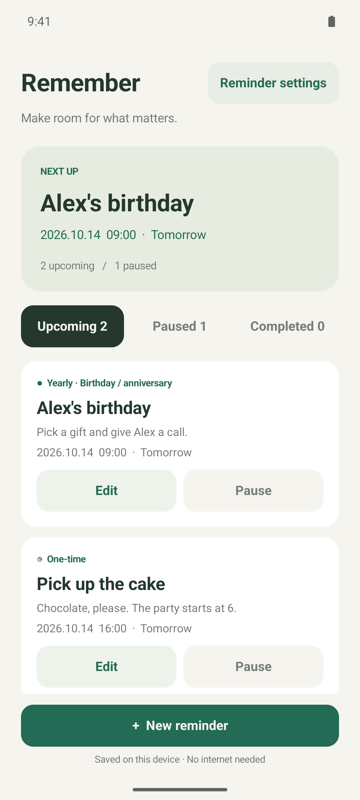
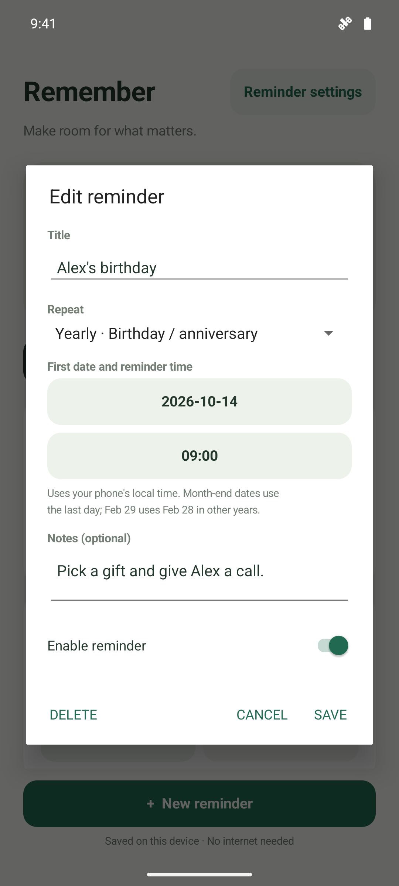

# Remember

**Make room for what matters.**

A quiet place for birthdays, anniversaries, and the things you only need to remember once. Set a reminder, choose its rhythm, and let your phone give you a nudge.

[**Download for Android ↓**](https://github.com/dentiny/event-notifier/releases/download/v0.1.1/remember-0.1.1.apk) · [Release notes](https://github.com/dentiny/event-notifier/releases/tag/v0.1.1)

v0.1.1 · Android 8.0+ · Works offline · No app account needed · MIT licensed

*This preview is hosted in a private repository. Downloading requires a GitHub account with repository access; the app itself needs no account.*

  
  &nbsp;
  

*Your next reminder at a glance. A simple form to make it yours.*

## For the moments that matter

- **Birthdays and anniversaries.** Repeat on the same date each year, at the time you choose.
- **One-off plans.** Remember to pick up a cake, make a call, or bring something along.
- **Everyday rhythms.** Choose daily, weekly, or monthly reminders for regular routines.
- **Plans change.** Edit a reminder or pause it until you're ready to resume.
- **Everything in its place.** Browse upcoming, paused, and completed reminders.

## Get started

1. [Download the APK](https://github.com/dentiny/event-notifier/releases/download/v0.1.1/remember-0.1.1.apk) on your phone and open it. Allow installation from your browser or file manager if Android asks.
2. Open **Remember**, tap **New reminder**, and choose a title, date, time, and repeat interval. Add a note if you like.
3. Allow notifications and follow the app's prompt to enable exact reminders. You can revisit these permissions through **Reminder settings**.

Reminders follow your phone's local time. Some phones may also need background activity allowed in battery settings to deliver reminders promptly.

## How reminders work

- **One-time reminders** move to **Completed** after the app sends a notification. This means the reminder has fired, not that you have finished the task.
- **Yearly reminders** keep the same month, day, and local time. February 29 uses February 28 in non-leap years.
- **Monthly reminders** use the last day of shorter months, then return to the original date: January 31 → February 28 → March 31.
- **Exact reminders are optional.** Standard reminders remain available when exact access is off or revoked, but Android may delay them. Notifications must be enabled.
- **After force-stopping Remember** in Android settings, reopen it to restore reminders. Pending reminders are restored after a restart once you unlock your phone; missed occurrences are caught up once.

## Yours, on your device

Remember works without an internet connection. Your reminders stay on your phone, with no account, server, or cloud sync. Uninstalling the app removes them.

---

[MIT license](LICENSE) · [Report an issue](https://github.com/dentiny/event-notifier/issues)
